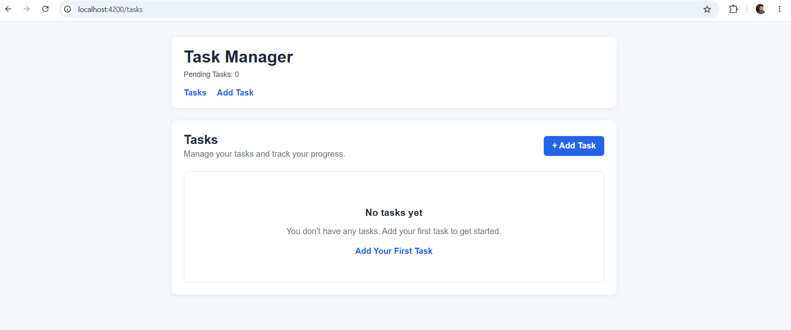
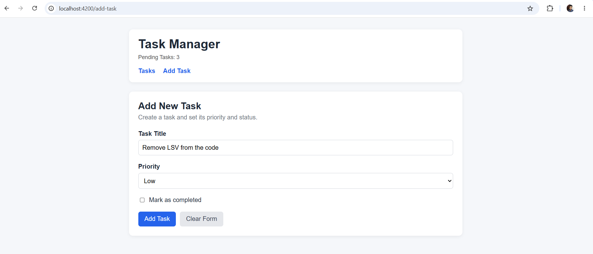

# Angular Task Manager — Assignment 2

A simple Task Management application built with Angular to demonstrate Angular Forms, Routing, Services, Dependency Injection, component-based architecture, and template binding.

## Project Description

This project extends the Task Manager application from Assignment 1 by restructuring the application using Angular services and routed views.

The application allows users to:

* View tasks
* Add new tasks
* Set task priority
* Set completed status
* Mark tasks as completed/uncompleted
* View the number of pending tasks
* Navigate between Task List and Add Task views
* Validate the Add Task form
* Clear the form

## Technologies Used

* Angular 22
* TypeScript
* HTML
* CSS
* Angular Router
* Angular Template-driven Forms

## Prerequisites

Make sure the following are installed:

* Node.js
* npm
* Angular CLI
* Git

Check the installed versions:

```bash
node -v
npm -v
ng version
git --version
```

## Setup and Run

Clone the repository:

```bash
git clone <repository-url>
```

Navigate to the project:

```bash
cd FST-6-angular-2
```

Install dependencies:

```bash
npm install
```

Start the development server:

```bash
ng serve
```

Open the application in your browser:

```text
http://localhost:4200
```

## Application Routes

| Route       | Description                |
| ----------- | -------------------------- |
| `/tasks`    | Displays the task list     |
| `/add-task` | Displays the Add Task form |

Navigation between views is handled using Angular Router.

## Features Implemented

### Task Management

* Create a new task
* Task title
* Low / Medium / High priority
* Completed / Pending status
* Mark task as completed
* Mark task as uncompleted
* Pending task count
* Empty task state
* Completed task styling
* Priority-based styling

### Angular Forms

The Add Task functionality uses a template-driven Angular form.

Form features include:

* Task title validation
* Required validation
* Minimum 3-character validation
* Validation messages
* Priority selection
* Completed status checkbox
* Add Task button
* Clear Form button
* Form reset after submission
* Navigation back to the Task List after submission

## Components Created

### AppComponent

Responsible for:

* Application layout
* Navigation
* Pending task count
* Router outlet

### TaskListComponent

Responsible for:

* Displaying tasks
* Displaying the empty state
* Displaying task priority
* Displaying completed status
* Marking tasks as completed/uncompleted

### TaskFormComponent

Responsible for:

* Adding new tasks
* Form validation
* Priority selection
* Completed status
* Clearing the form
* Navigating back to the task list after submission

## Task Service

### TaskService

The `TaskService` is responsible for managing task data and operations.

It provides methods to:

* Maintain the task list
* Retrieve tasks
* Add tasks
* Toggle completed status
* Calculate pending task count

The service is provided using Angular Dependency Injection:

```typescript
@Injectable({
  providedIn: 'root'
})
```

## Dependency Injection

The `TaskListComponent` and `TaskFormComponent` use the injected `TaskService` to access and modify task data.

```text
             TaskService
                  |
          +-------+-------+
          |               |
          v               v
    TaskListComponent  TaskFormComponent
```

This keeps task management logic inside the service instead of directly managing the task list inside the components.

## Angular Concepts Demonstrated

The application demonstrates:

* Angular Components
* Angular Services
* Dependency Injection
* Angular Router
* RouterLink
* RouterOutlet
* Template-driven Forms
* `ngModel`
* Form validation
* Interpolation
* Property binding
* Event binding
* Two-way binding
* `@if`
* `@for`
* Conditional classes
* TypeScript interfaces

### Interpolation

```html
{{ task.title }}
```

### Property Binding

```html
[class.completed]="task.completed"
```

### Event Binding

```html
(click)="taskService.toggleTask($index)"
```

### Two-way Binding

```html
[(ngModel)]="title"
```

### Conditional Rendering

```html
@if (task.completed) {
  <span>✓ Completed</span>
}
```

### Looping

```html
@for (task of taskService.getTasks(); track $index) {
  ...
}
```

## Screenshots

### Task List



The Task List view displays the available tasks, their priority, completion status, and pending task count.

### Add Task



The Add Task view allows users to enter a task title, select a priority, set the completed status, submit the task, or clear the form.
